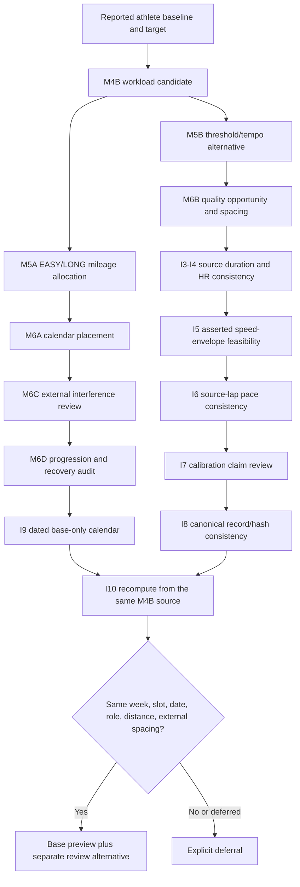

# Engine 1.5 independent candidate — Astra review packet

**Review status:** packet prepared; Astra review has **not** been requested or performed in this development cycle. Owner instruction prohibits another audit until model-usage allowance resets. This packet does not waive that review gate.

## Exact candidate and reproduction

- Repository: `Isshhin/stridelab-development`
- Algorithm candidate commit: `254d36d55d1d3eec1cf160f5008c061bc3fe8edf`
- Candidate branch: `research/engine15-cohesive-candidate-20261117`
- Starting source commit: open draft I9 PR #129 head `cf209b710268f116feac96154f53cb17779dbf73`
- Candidate worktree was isolated from the owner's dirty primary checkout. `dev` and `main` were not changed. No production plan, stored workout, historical activity, feature switch, or migration was changed.
- Environment: JBR 21.0.11, Gradle 8.13, Android SDK at the local configured SDK path.

From `native-android`:

```powershell
.\gradlew.bat -PstrideEngine15Active=true :app:testDebugUnitTest --no-daemon --max-workers=2
.\gradlew.bat -PstrideEngine15Active=true :app:assembleDebug :app:assembleDebugAndroidTest --no-daemon --max-workers=2
.\gradlew.bat -PstrideEngine15Active=true :app:testDebugUnitTest `
  --tests "io.stridelab.privatealpha.Engine15I8CalibrationArtifactIntegrityTest" `
  --tests "io.stridelab.privatealpha.Engine15I9ReadOnlyBasePlanAssemblyTest" `
  --tests "io.stridelab.privatealpha.Engine15M5QualityPreviewComposerTest" `
  --tests "io.stridelab.privatealpha.IndependentQualityTemplatesTest" `
  --no-daemon --max-workers=2
```

The targeted saved-plan and safety regression command used these classes: `BackupIntegrityTest`, `LocalPlanOwnershipTest`, `CoordinatedEngine1Test`, `TracksideCoachingIntegrationTest`, `AutonomousReliabilityRegressionTest`, and `ExerciseLibraryV2Test`.

## Architecture and decision flow



M4B–M6D plus I9 produce a read-only, exact-distance EASY/LONG calendar. M5B/M6B offer one unscheduled threshold or tempo alternative on an existing EASY slot. I3–I8 check increasingly detailed caller-supplied source, physiological and calibration claims but do not authenticate the athlete, device, issuer, protocol, workout family, intensity, tolerance or permission. I10 recomputes both branches from the same typed M4B input, compares the entire base calendar and rechecks asserted cross-discipline conflicts. The quality alternative remains outside the base mileage budget and is not distance reconciled, scheduled, executable or production authorized.

The independent work does not replace the overlapping M10.6 generator or its existing UI. M10.6 history wording was corrected from “verified” to “reported”; its selection policy was not changed. Existing Engine 1.0 rollback, saved-plan protections, signed-out/offline behavior and approval-first controls remain in place.

## Verification results

| Check | Result |
|---|---:|
| Full JVM unit suite | **996 tests / 129 suites; 0 failures; 0 errors; 1 skipped** |
| Skipped test | `Engine15Q1QualityBaselineTest.captureActualGeneratorOutputAcrossEightWeeks`; no skip reason was recorded |
| Focused I8/I9/M5/template set | **40 passed; 0 failed/errors/skipped** |
| Ownership, backup/restore, rollback, offline and reliability subset | **58 passed; 0 failed/errors/skipped** |
| Debug APK compile (`assembleDebug`) | Passed |
| Instrumentation APK compile (`assembleDebugAndroidTest`) | Passed |
| Instrumentation test execution | Not run |
| Emulator/device acceptance or installation | Not run; no physical device was touched |

Unit tests establish implementation invariants and repeatability only. They do not establish that this plan is physiologically appropriate, safe, tolerable or effective for a real runner. The debug APK build is not device acceptance.

## Representative multiweek plan outputs

### 8-week 75→80 km, six days, Thursday unavailable

- Weekly budgets: **67.5, 71.2, 75.0, 60.0, 71.2, 75.0, 78.7, 62.9 km**.
- Peak: **78.7 km**; requested 80 km shortfall at peak: **1.3 km**. Recovery weeks: 4 and 8.
- Calendar variant tested: Saturday LONG, Sunday EASY, no Thursday run. A compatible Monday EASY slot can be reported as one quality opportunity, but remains unscheduled.
- First-week long run: **20.2 km**. The existing 30% M5A share slightly exceeds the requested 18–20 km ideal; the test records the 0.2 km preference gap.

### 16-week 75→80 km, six days, Thursday unavailable

| Week | Weekly km | Saturday long km | Phase |
|---:|---:|---:|---|
| 1 | 67.5 | 20.2 | Build |
| 2 | 71.2 | 21.0 | Build |
| 3 | 75.0 | 21.0 | Build |
| 4 | 60.0 | 18.0 | Recovery |
| 5 | 71.2 | 21.0 | Build |
| 6 | 75.0 | 21.0 | Build |
| 7 | 78.7 | 21.0 | Build |
| 8 | 62.9 | 18.8 | Recovery |
| 9 | 75.0 | 21.0 | Build |
| 10 | 78.7 | 21.0 | Build |
| 11 | 80.0 | 21.0 | Target reached in budget |
| 12 | 64.0 | 19.2 | Recovery |
| 13 | 78.7 | 21.0 | Build |
| 14 | 80.0 | 21.0 | Target in budget |
| 15 | 80.0 | 21.0 | Target in budget |
| 16 | 64.0 | 19.2 | Recovery |

The candidate's current long-run allocation produces **21.0 km in most build weeks**, above the requested 18–20 km ideal. It preserves the existing policy and exposes this gap; it does not claim the preference was satisfied. Total proposed distance over 16 weeks is **1161.9 km**. This deterministic synthetic simulation contains 96 dated base runs and has no measured athlete response.

## Workout-generation examples

| Versioned example | Structure | Exact accounting | Status |
|---|---|---|---|
| `engine15-threshold-intro-v1` | 10 min easy warm-up; 3×4 min threshold; 2 min easy between reps; 8 min cool-down | 12 min work, 4 min recovery, 34 min total | Heuristic research preview |
| `engine15-threshold-extended-v1` | 10 min warm-up; 4×5 min threshold; 2 min easy between reps; 10 min cool-down | 20 min work, 6 min recovery, 46 min total | Heuristic research preview |
| Tempo intro/extended | Continuous 12 or 20 min tempo, with easy warm-up/cool-down | No interval recovery; selected work remains bounded by reported same-family exposure and a supplied ceiling | Heuristic research preview |
| `engine15-threshold-long_repetitions-v1` | 2 km easy warm-up; 3×3 km threshold; 90 sec easy between reps; 2 km easy cool-down | 9 km threshold work; two recoveries = 3 min; the fixed-distance segments total 13 km, plus unknown recovery distance; elapsed duration unknown | Illustrative mixed-unit preview only |

No arbitrary session time cap is inferred when the user supplied none. An explicit user time limit, including zero, is distinct and binds selection. Missing exposure or a missing reviewed work ceiling defers; it is not replaced by an assumed duration. The 3×3 km example is not selectable by the timed M2 selector and cannot enter exact kilometer reconciliation until recovery distance has a supported contract.

## Scenario and adversarial coverage

- Six-day 75→80 km plan with Thursday off, Saturday LONG, Sunday EASY, quality opportunity, and exact weekly arithmetic.
- 16-week output with four recovery cycles; repeated assembly equality; exact daily/weekly sums; target shortfall and long-run preference gaps retained.
- Beginner and established synthetic profiles: 8 and 20 minutes of explicit reported same-family work produce correspondingly bounded previews. Experience labels do not supply dose. No lab test is required by the ordinary preview selector; an external review and other stated inputs are still asserted, not authenticated.
- Unknown/zero work exposure, unknown ceiling, unauthorized quality, recovery/return hold, two-day schedule, long-run slot, recovery week and explicit time conflict defer.
- Two quality requests in one week defer as `MULTIPLE_QUALITY_REQUESTS_IN_WEEK`; the current M5B ceiling is one per week.
- I10 tests matched calendars, mismatched long-day placements, absent artifact, same-day external session and next-day lower-body hard work. Same-day EASY/upper pairing allowed in the base does not qualify that day for quality.
- Existing I1/I2/I3–I8 tests cover implausible targets, missing/partial history, returning runners, source/pace/HR gaps, duplicate activity/session claims, invalid or conflicting calibration artifacts, and distance-envelope conflicts.

Coverage remains synthetic and mostly fixture-based. No prospective coaching observations, external fitness expert rating, source issuer verification, authentic lab protocol validation, real user history sampling, or long-term injury/outcome data was used.

## Workout-family authorization boundary

| Class | Current independent-candidate disposition |
|---|---|
| Safe to display as research structure | Threshold intervals and continuous tempo with heuristic labels, visible reported-work/ceiling inputs, and explicit constraints. “Safe to display” is not approval to perform the workout. |
| Requires external review | Athlete-specific selection, any dose increase, and all threshold/tempo inputs based on caller reports. I8 supplies an external-review packet only. |
| Must defer | Missing usable family exposure, missing ceiling/review, recovery or return hold, conflicting placement, a same-week second quality request, explicit time conflict, mixed-unit distance without segment evidence, or I10 calendar/external conflict. |
| Executable/production eligible | **None. Disabled pending independent evidence and separate owner authorization.** |

Progression tempo, Fartlek, VO₂max intervals, strides and hills remain illustrative-preview/defer only in the independent library. Their family-specific selection, tolerance, intensity, recovery-frequency and mileage rules are not qualified here. M10.6's existing labels do not authorize these families in the independent engine.

## Provenance, authorization and limitations

- I3 source/session/lap links, I4 HR samples, I5 speed windows, I6 pace consistency, I7 test claims and I8 canonical bytes/hash are caller-supplied. I8 proves internal byte/claim consistency only; it does not authenticate the issuer, athlete, source device, sensor or protocol.
- Recorded timing, HR and pace consistency do not verify threshold/tempo/VO₂max intensity, athlete response, recovery tolerance or safe weekly frequency.
- I5 speed envelopes are asserted bounds, not prescribed or observed future segment paces/distances. Timed alternatives remain unreconciled to exact base kilometers.
- Current one-quality-per-week policy is conservative but unvalidated as a universal rule; cumulative dose/frequency across two sessions is not implemented.
- The 18–20 km long-run preference is not met in many loading weeks by the current 30% allocation. There is no reviewed policy change in this candidate.
- Progression, recovery and long-run shares remain deterministic heuristics. They are not clinically validated or calibrated to longitudinal athlete outcomes.
- The local JVM suite includes one skipped legacy generator-capture test. Instrumentation APK compilation passed, but instrumentation execution, emulator acceptance and live source integration were not performed.
- GitHub Actions for the starting PR #129 had failed before useful steps on its earlier head; no hosted CI run was made on this candidate branch.
- There is no separate Astra audit, production switch, merge, or device installation in this cycle.

## Questions for independent algorithm review

1. What independent evidence would be sufficient to classify repeated work laps as threshold or tempo exposure rather than duration-only consistency, and how should caller-asserted family labels be excluded from authorization?
2. What workout-specific protocol should reconcile timed warm-ups, work, recoveries and cool-downs to exact daily/weekly distance without treating an asserted speed range as actual pace?
3. What cumulative workload, spacing and recovery evidence would justify more than one quality session in a week for a given athlete, and when should a second request be held or deferred?
4. For the 75→80 km, six-day case, should an 18–20 km preferred long run override the existing 30% M5A share when the reported longest run is 20 km, or should the plan report an explicit weekly/long-run shortfall instead? What evidence would support either choice?
5. Which source/issuer, participant identity, device, sensor and protocol attestations are prerequisites before calibration claims or HR/pace data can influence an executable prescription?
6. Which family-specific policies are still missing before progression tempo, Fartlek, VO₂max, strides or hill workouts can progress beyond illustrative status?
7. How should the independent M4B–I10 policies coexist with M10.6 without duplicating or silently superseding workload, quality-frequency and saved-plan approval decisions?

## Review handoff

Suggested review order: inspect exact candidate commit and diff; reproduce the full JVM suite and focused scenario commands; inspect I10 same-source and external-conflict invariants; challenge the 16-week target/long-run tradeoff; evaluate the family policy gaps and evidence boundary; report any independent algorithm or coaching defects before any request to change production eligibility. Astra review remains pending until the owner's model-usage allowance permits it.
